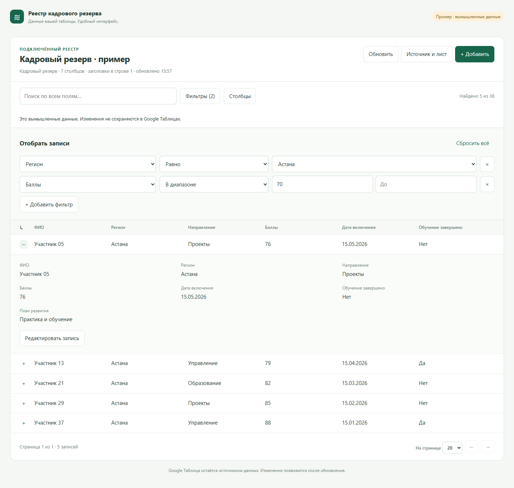

# Talent Pool Registry

**Paste a Google Sheets link. Get searchable profiles and filters built from your own columns.**

[Русская версия](README.ru.md) · [Setup guide](docs/setup.md)


A standalone Google Apps Script web app for working with talent pool records and other tabular data.
The GitHub edition adapts to the connected sheet: it no longer requires two particular documents,
predefined Russian/German headings, Script Properties or an employee-ID initialization step.

## How to use it

1. Deploy the app once in Google Apps Script using the [setup guide](docs/setup.md).
2. Open the app, sign in to Google and paste a Google Sheets URL.
3. The app detects a header row, discovers the available columns and builds the interface.
4. Search across all fields, add filters for any column, open a full record or select another worksheet.

Users need access to their source document. Each user's connection is stored privately in User Properties;
there is no shared document URL or shared personnel cache. Connecting reads the sheet without adding ID columns.

## What adapts automatically

| Data found in a column | Generated filter |
| --- | --- |
| Text with a short list of distinct values | Dropdown |
| Free text or a name | Text search |
| Numeric cells | Minimum / maximum |
| Google Sheets date cells | Date range |
| Boolean cells / checkboxes | Yes / no |
| Any column | Empty / not empty |

Headers become field labels. Duplicate and unnamed columns receive distinct display labels while retaining
their physical column positions. Mixed-type columns fall back to text. Phone numbers and identifier-like
columns retain their displayed text, including formatting such as leading zeroes.

The first plausible multi-cell row among the first 20 rows is used as the header. You can override it
under **Source and sheet** (rows 1–30). Complex merged or multi-level headings can require this adjustment.



## Other features

- All-field search, sortable columns, pagination and selectable list columns.
- Expandable profiles containing every discovered field; mobile card layouts.
- Dynamic editing and creation forms, subject to Google Sheets edit permissions.
- Existing formula cells are read-only. Stale row/schema revisions reject conflicting edits.
- Failed writes attempt recovery; creation retries are deduplicated for the last 100 completed requests per user.
- Explicit in-memory demo mode with fictional data; connection errors never silently load demo records.

## Install

Copy these five files into a standalone Apps Script project:

- `Code.gs`
- `Index.html`
- `Model.html`
- `Client.html`
- `appsscript.json`

Deploy as a web app **executing as the user accessing the web app**. The manifest selects
`USER_ACCESSING`; verify that choice in the deployment dialog. Each user authorizes the app and works
with their own spreadsheet permissions. A runtime identity check rejects execution under a different user's authority.

There is no separate server to install. This is an Apps Script app, rather than a static GitHub Pages app:
opening the HTML locally supports the fictional demo, but connecting a private sheet requires the deployed app.

## Limits and data integrity

One worksheet is displayed at a time; worksheets are not automatically joined by names or IDs.
Use one header row and one record per row. Empty sheets require headers before connecting.
Reads are bounded to 5,000 source rows, 100 columns, 100,000 cells and about two million display characters.
When the read is partial, the app explicitly warns that filters cover the loaded portion only.

Edits use the current physical row number plus a revision of its values, formulas and schema. They do not
create stable identifiers in the source. External changes and row movement generally require a refresh.
Writes are not database transactions: incomplete recovery may need manual reconciliation.
New records do not copy source formulas or formatting. Protected ranges can make the loaded block read-only.

## Development and checks

No dependencies are needed for the backend and filtering regression checks:

```sh
node tests/backend.cjs
node tests/model.cjs
```

Optional browser checks use Playwright:

```sh
npm install --no-save --package-lock=false playwright
npx playwright install chromium
node tests/ui.cjs
```

Tests use generated or fictional records and mocked Apps Script services. They cover schema discovery,
per-user isolation, type inference, permissions, conflicts, recovery, filters, responsive UI and escaping.
They do not substitute for authorizing and smoke-testing an actual Apps Script deployment.

## Repository

| Path | Purpose |
| --- | --- |
| `Code.gs` | Per-user connection, sheet discovery, schema inference and guarded writes |
| `Index.html` | Responsive connection screen, registry and forms |
| `Model.html` | Filtering, sorting and pagination |
| `Client.html` | Browser interaction and explicit synthetic demo |
| `examples/` | Two unrelated fictional schemas for trying different columns |
| `tests/` | Portable backend, model and optional UI checks |

The repository contains no real personnel data, source sheet URLs or account credentials.
The email scope is used only to verify that the active user and execution user match; the app does not
return or log those email addresses. Do not deploy personnel data for anonymous access.
No open-source license has been selected for this project yet.
