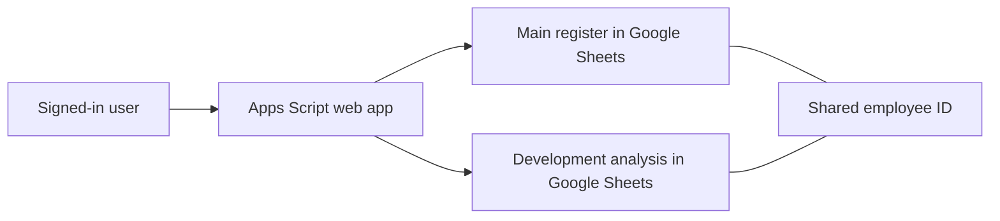

# Talent Pool Registry

**A Google Apps Script web app for working with personnel and talent-development data in Google Sheets.**

[Русская версия](README.ru.md) · [Setup guide](docs/setup.md)


The app brings a main personnel register and a development-analysis sheet into one searchable
interface. Users can open profiles, filter the list and edit supported fields without working
directly in a wide spreadsheet.

## Features

- A responsive list with filters, pagination and expandable profiles.
- A unified editor and a form for creating participants.
- Stable `Сотрудник_ID` identifiers link records across two source tables.
- Per-source editing permissions based on the signed-in user's spreadsheet access.
- Revision checks catch stale edits before writing; guarded writes attempt rollback on failure.
- Literal text handling protects editable text fields from accidental spreadsheet formulas.
- One page scroll, mobile layouts and a back-to-top control.

## Quick start

1. Create two **Google Sheets** documents. The synthetic CSVs in `examples/` can seed a demo.
2. Create an Apps Script project with `Code.gs`, `Index.html` and `appsscript.json`.
3. Add Script Properties using the keys shown in `config.example.json`.
4. Run `initializeEmployeeIds` as an editor of both tables, then `checkConnection`.
5. Deploy as a web app **executing as the user accessing the web app**.
6. Restrict deployment access to the intended audience and share the source Sheets with those users.

See [setup](docs/setup.md) for schema mapping, permissions and updates.
Configuration JSON is a reference; it is not imported automatically.

## How it works



| File | Purpose |
| --- | --- |
| `Code.gs` | Sheet discovery, stable IDs, access checks, validation and writes |
| `Index.html` | Responsive client and editing forms |
| `appsscript.json` | V8 runtime and spreadsheet scope |
| `examples/` | Small, entirely synthetic tables |

## Deployment and limitations

Google Apps Script and Google Sheets provide the runtime and storage; there is no separate database server.
The deployment must execute as the accessing user for per-user spreadsheet permissions to apply.
Changing it to execute as the owner changes the access model.

Initialization writes stable IDs to the tables. Review duplicate names first; ambiguous matches are rejected.
Use test copies for initial setup. Cross-file rollback is best effort, rather than a database transaction;
an incomplete rollback can require manual reconciliation. Existing formula cells are protected from editing.

The configured column names include German and Russian headings. Adapt `SCHEMA_` for a different layout.
This is a record-management tool; it does not rank participants or make employment decisions.

## Privacy and licensing

The repository contains code and synthetic examples only. It does not contain actual personnel records,
source sheet URLs or deployment IDs. Keep production documents, exports and account credentials outside Git.
Do not deploy personnel data for anonymous public access.

No open-source license has been selected for this project yet.

## Local regression checks

The backend regression checks run against in-memory Sheets mocks and generated synthetic records.
They cover stable IDs, permissions, stale edits, validation, rollback and creation retries.
Node.js is required. They do not call Google services or replace a deployment smoke test.

```sh
node tests/backend.cjs
```
